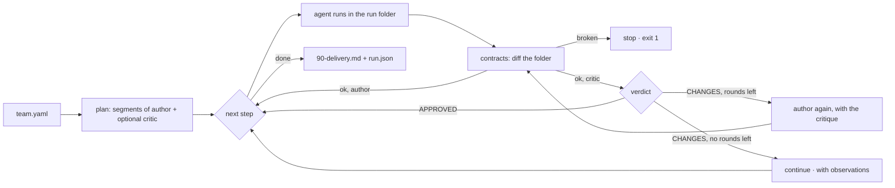

# agent-rounds

Run a team of coding agents where **the process is code**: every role writes only its own files, every critique ends in a verdict, and review rounds actually happen. No LLM "lead" deciding whether to skip a step.

> **Status: pre-release.** The runner, the contracts and the deterministic `mock` agent work today. The Claude Code adapter (`claude -p`), the `init design` template and the npm release land in v0.1.0. See [Roadmap](#roadmap).

## Why

Agent teams usually have an LLM as the lead. It skips rounds, accepts a critique that said "changes needed", lets one role overwrite another's work, and leaves no record you can replay or price.

agent-rounds keeps the content with the agents and moves the process into a small, boring program:

- **Roles and handoffs live in `team.yaml`**: who reads what, who writes what, who critiques whom.
- **Contracts are checked after every step**, by diffing the run folder. A broken contract stops the run with a non-zero exit code.
- **Review rounds are a loop, not a suggestion**: `CHANGES` sends the work back to its author, up to `max_rounds`.
- **Every run is a folder you can audit**: the request, each role's files, `run.json` with timings and cost, and a `90-delivery.md` built from a template.

## Quickstart

Not on npm yet. From a clone:

```bash
npm ci
npm run dev -- run "Design two onboarding screens for the Mate & Co. mobile app." --team examples/design-team/team.yaml
```

```text
agent-rounds · team design · agent mock
→ runs/2026-11-14-142540-design-two-onboarding-screens-for-the
✓ research
✓ spec
✓ ux-critic-spec round 1 → CHANGES
✓ spec round 2
✓ ux-critic-spec round 2 → APPROVED
✓ prototype
✓ ux-critic-prototype round 1 → CHANGES
✓ prototype round 2
✓ ux-critic-prototype round 2 → APPROVED
✓ design-system

✓ done: 6 roles · 10 steps · 4 review rounds · 0 broken contracts · US$ 0.00 (mock) · 0.0s
→ runs/2026-11-14-142540-design-two-onboarding-screens-for-the/90-delivery.md
```

The `mock` agent writes deterministic placeholder files, so you can try the whole flow without spending tokens. A full mock run is versioned in [`examples/design-team/runs/`](examples/design-team/runs/2026-11-14-onboarding-mate-and-co/90-delivery.md).

## How it works



- **Order.** Roles run top to bottom. A critic sits right after the role it reviews.
- **Contracts.** After each step the runner snapshots the run folder and checks:
  1. `writes-exist`: every file in the role's `writes` exists and is not empty.
  2. `writes-only-own-files`: the role created, changed or deleted nothing outside its `writes`.
  3. `verdict-line`: a critique's last non-blank line is exactly `APPROVED` or `CHANGES`.
- **Rounds.** On `CHANGES` the author runs again with the critique as input, then the critic reviews again. When `max_rounds` runs out the run continues and the delivery marks that review "with observations".

### team.yaml

```yaml
name: design
roles:
  - id: research
    prompt: roles/research.md # system prompt for this role, relative to team.yaml
    reads: [00-request.md]
    writes: [10-research.md]

  - id: spec
    prompt: roles/ui-spec.md
    reads: [00-request.md, 10-research.md]
    writes: [20-spec.md]

  - id: ux-critic-spec
    prompt: roles/ux-critic.md
    critic_of: spec # reviews the files of the role right above
    writes: ["30-spec-critique-{round}.md"] # quote paths with {round}
    max_rounds: 2 # default 2, max 5

  - id: prototype
    prompt: roles/prototyper.md
    reads: [20-spec.md]
    writes: [40-prototype/] # trailing slash: the role owns the whole folder
```

Validation errors point at the line: `team.yaml:15:16  roles[2].critic_of: unknown role "spek"`.

### A run folder

```text
runs/2026-11-14-142540-design-two-onboarding-screens/
├── 00-request.md          ← written by the runner
├── 10-research.md         ← one file (or folder) per role
├── 20-spec.md
├── 30-spec-critique-1.md  ← ends in CHANGES
├── 30-spec-critique-2.md  ← ends in APPROVED
├── 40-prototype/index.html
├── …
├── 90-delivery.md         ← template, no LLM
└── run.json               ← steps, verdicts, durations, cost
```

### Commands

| Command                        | What it does                                                                               |
| ------------------------------ | ------------------------------------------------------------------------------------------ |
| `agent-rounds run "<request>"` | Runs the team. Options: `--team`, `--agent`, `--runs-dir`, `--timeout` (minutes per step). |
| `agent-rounds validate`        | Checks `team.yaml` without running anything.                                               |

Exit codes: `0` done (with or without observations), `1` a contract broke or an agent failed, `2` invalid `team.yaml` or arguments.

## Alternatives

| Tool                                                                                                                                      | Use it instead when                                                                |
| ----------------------------------------------------------------------------------------------------------------------------------------- | ---------------------------------------------------------------------------------- |
| [Claude Code agent teams](https://addyosmani.com/blog/claude-code-agent-teams/)                                                           | You want agents talking to each other live, and you are there to steer.            |
| [designpowers](https://github.com/Owl-Listener/designpowers)                                                                              | You want a ready-made design team and are fine with the model running the process. |
| [VS Code custom agent handoffs](https://code.visualstudio.com/docs/agents/reference/custom-agent-file-reference)                          | You want to click through handoffs yourself, inside the editor.                    |
| [agent-handoff](https://github.com/laiyaom/agent-handoff), [orquestador-handoffs](https://github.com/ArlanzaCapital/orquestador-handoffs) | Your loop is just implement → review → fix on code, with two roles.                |
| [cli-agent-orchestrator](https://github.com/tony/cli-agent-orchestrator)                                                                  | You want an LLM supervisor coordinating CLI agents in tmux.                        |

Checked on 14 November 2026.

## Roadmap

- **v0.1.0**: Claude Code adapter (`claude -p --output-format json`, with cost), `agent-rounds init design`, a recorded demo and the npm release.
- **v0.2**: Codex and Copilot adapters, a different agent per role, `resume`, parallel roles, an HTML run viewer.
- **v0.3**: run a team from a GitHub issue, with the preview on Pages and the critique in the thread.

## Development

agent-rounds is built spec-first with [OpenSpec](https://github.com/Fission-AI/OpenSpec): what the tool promises lives in [`openspec/specs/`](openspec/specs/), and every behavior change starts as a proposal with delta specs in `openspec/changes/` before any code. See [CONTRIBUTING.md](CONTRIBUTING.md) for the flow and [AGENTS.md](AGENTS.md) for the rules coding agents follow. `npm run check` runs lint, types, tests and the build. Design decisions are in [`docs/decisions/`](docs/decisions/).

## License

[MIT](LICENSE)
